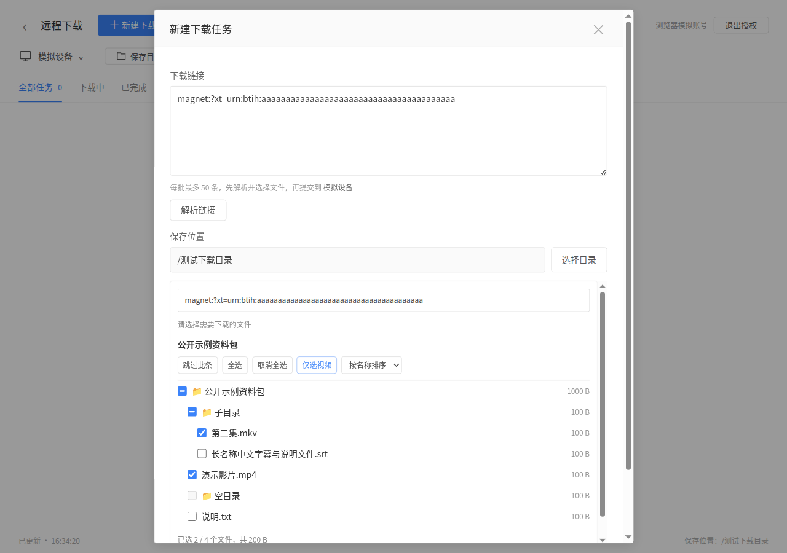

# 内置远程下载

## 组成

- `pkg/remote` 使用标准库实现迅雷登录、短信验证、令牌续期、设备发现、目录查询和任务管理。
- `pkg/remoteweb` 提供管理页面和同源接口，页面通过 `go:embed` 打入可执行文件。
- `xlp.go` 在进入隔离环境后，使用转换后的数据目录创建远程客户端，并挂载到已有网页服务。
- 功能默认融入原版面板侧栏，无需启用参数；首页和已有面板访问配置保持原有行为。

`Panel` 只在 CGI 首页的 HTML 响应中加入侧栏扩展脚本和样式，其他接口及文件传输直接透传。扩展以原有「下载列表」菜单的结构和样式创建「远程下载」项，并跟随原界面更新重新挂载。选择远程页签时，在原内容区显示同源内容视图，原侧栏仍然可用。

首页注入按 HTML 词法上下文定位实际结束标签，跳过脚本、注释和模板内容，保留原页面的字节；已有扩展按标签属性识别。响应缓冲和 gzip 解压都限制为 4 MiB，超限或无法安全注入时保留原响应。处理器主动刷新时，立即输出已有缓冲并转为原文透传，该响应不再注入。信息响应不会阻止后续最终响应，最终响应头使用首次正式写头时的快照，并保留尾部字段和底层响应控制能力。

页签使用原路由上的 `xlpRemote=1` 查询标记，不注册未知路由。支持原页签切换、前进后退和刷新恢复；离开远程页签时暂停自动刷新。内容视图自身不再包含侧栏。套件文件不被改写，运行时扩展会在升级后的页面上重新加载。

选择原侧栏菜单时主动清除远程标记，即使原菜单指向当前路由也会恢复原内容区。登录窗口仅在本次提交账号后显示对应的验证入口；关闭窗口、修改账号或重新登录会清理旧验证界面、短信倒计时，并忽略旧请求迟到的界面更新。

## 请求链路

账号登录依次调用 `xluser.core.login/v3/login`、`v1/shield/captcha/init`、`v1/auth/signin/token`；访问令牌通过 `v1/auth/token` 续期。业务人机令牌使用带用户标识及签名的参数形态。短信验证兼容 JSON、JSONP 和响应 Cookie，验证成功后上报并重新换取登录态。

接口明确返回 `errorCode` 或 `error_code` 为 `0`，或通过 `error` 返回 `success`、`ok`、`0` 成功标识时，`errorDesc`、`error_description` 仅作为说明，不据此判定失败；非零错误码和其他错误标识仍会被拒绝。成功标识兼容大小写和前后空白，也允许省略数字错误码。短信发送成功后保存验证令牌和发送时间，供提交验证码及限制重发频率使用。

短信响应的正文与 Cookie 分别检查失败标识，任一来源明确失败时都不能被成功字段覆盖；Cookie 只补足正文缺失的字段。短信上报是完成验证的必要步骤，必须收到有效的 `code=200` 确认后才继续登录。上报失败返回具体阶段，校验成功凭据、上报完成状态和已取得的登录会话保存在受保护的状态文件中，供用户重试时从后续步骤继续；不保存短信验证码，也不自动重复校验已经通过的验证码或重新发送短信。未选择记住密码时，重启后尚需密码的核心登录仍须重新输入账号密码。

短信会话过期后只尝试一次恢复登录；若得到正常登录会话，直接换取令牌并结束旧验证流程，若仍需新的短信验证，则保存新入口并提示用户主动获取验证码。已完成校验或已取得登录会话时，再次请求获取短信也只会继续后续步骤。

短信响应无法识别且没有非零错误码时，页面提示具体失败步骤，服务日志记录「短信验证响应摘要」。摘要只包含字段类型和令牌、结果、说明是否存在，不记录账号、验证码、令牌或上游原文。

设备来自 `drive/v1/tasks?type=user%23runner`。目录服务通过 `drive/v1/apps/INNER_API` 发现，保留返回地址的路径前缀，并携带插件凭据调用设备中继。目录列表只按文件夹类型过滤，支持分页和中继地址重新发现。浏览、默认设置和创建任务仍按所选路径解析，保留路径中的空格、全角空格等有效字符；只有空字符串表示未选择路径，不会裁掉空白后改选其他目录。解析在每层列表读完后选择最长匹配路径；若该路径对应不同目录编号，则返回目录不明确错误，不继续浏览、保存设置或发送创建请求。同一编号的重复项去重，同名但实际路径不同的目录可分别选择。

资源解析及任务创建使用云端 `drive/v1/resource/list` 和 `drive/v1/task`。创建任务同时提交设备空间、目标设备、父目录编号与路径。任务列表按页返回；暂停和继续先在所选设备中查询真实任务类型，再更新状态。接口同时检查 HTTP 状态与迅雷业务错误码。

### 资源预览与文件选择

新建窗口先逐条解析链接，再选择文件和确认下载。解析复用 `NormalizeLink`，迅雷包装链接内部是磁力时执行磁力规则，协议名称大小写不影响判断。解析不访问下载目录，不创建任务或写入提交记录；只有完整成功的预览才能参与首次创建。普通直链确认为一个叶子对象时采用 `single` 模式，其他资源采用 `files` 模式，磁力单文件也必须具有真实索引并经过可见确认。

`pkg/remote/resource.go` 将上游树合并为扁平节点列表。根列表及目录后续页按各自的不透明令牌补齐，新页中的子目录也会继续加载。完全一致的节点可去重，编号冲突、索引冲突、错误父节点、循环、缺少索引、无效大小或明确的总数不符均拒绝。大小以十进制字符串返回，页面用 `BigInt` 汇总；文件索引限制在 JavaScript 安全整数范围内，索引零和稀疏索引均有效。名称通过 `textContent` 展示，不作为 HTML 或本地路径执行。

服务端为完整结果生成随机 128 位预览编号和 SHA-256 内容版本。内容版本使用结构化编码，包含资源模式、叶子数量、真实索引、原始路径段及大小，不包含临时节点编号、列表编号、分页顺序或有效期。目录和文件同名可分别展示；排序只影响显示，空目录不能作为下载项。

预览保存在内存，按账号、用户标识、会话代数、设备和规范化链接绑定，有效期从完整解析结束起计算十分钟。同内容的有效预览可以复用；容量满时拒绝新增，不淘汰正在使用的有效项。状态实际采用新账号或设备后清空缓存，包括文件替换后目录同步失败的情况；普通令牌续期保留缓存。服务重启会丢失预览，已提交记录仍可核对。

| 本地限制 | 当前值 |
| --- | --- |
| 单条叶子文件 / 全部节点 | 5000 / 10000 |
| 节点最大深度 | 64，根为第一层 |
| 单条解析请求数 / 总时长 | 64 次 / 60 秒，解析接口总时长包含等待操作锁 |
| 单响应 / 累计响应正文 | 8 MiB / 16 MiB |
| 单预览序列化大小 | 4 MiB |
| 缓存条目 / 累计规范化数据 | 64 / 64 MiB |
| 创建正文 / 其他写接口正文 | 128 KiB / 32 KiB |

这些是本地首版限制，缓存按序列化大小计费，并不等于实际 Go 堆占用。超大种子需使用迅雷客户端；首版不使用目录转索引接口或本地 DHT，也不会退回全量创建。

创建时先处理已有请求编号，再校验有效预览、账号、设备、链接、内容版本、模式及索引集合。索引去重排序后只能取自快照，所选大小由服务端计算；在目录网络查询完成后再次检查取消及有效期。发送前保存不可变提交意图。`files` 模式的 `sub_file_index` 是显式集合，例如 `[0, 2, 3, 5]` 编码为 `0,2-3,5`，全选也不用特殊全量字符串；上游 `file_size` 为所选大小，`total_file_count` 为资源原叶子总数。`single` 模式不接受子文件集合，选择参数为空字符串。

页面支持目录三态、全选、取消全选、仅选视频和按名称或大小排序。每条链接可独立编辑或跳过；解析取消、关闭重开、账号或设备变化均废弃旧成功、错误和收尾。提交期间冻结选择并阻止关闭，关闭浏览器不能视为取消设备下载。页面显示实际将提交及跳过数量；预览过期需要重新解析，同内容才恢复选择。

界面示例使用模拟账号、资源和任务服务：



[窄屏文件选择截图](images/磁力文件选择-窄屏.png)

任务进度优先使用上游百分比，兼容参数中的下载字节数与速度，文件下载完但仍在校验时显示校验进度。页面每 15 秒刷新已加载的所有页，切换分类也会刷新；操作提交与刷新重叠时会补刷。成功提示在刷新完成、切换页签或 5 秒后清除。

状态、设备和目录查询只接受最新请求的结果；账号或设备改变后，旧会话的查询成功、错误与收尾都不再影响当前界面。目录窗口关闭或重新打开会废弃旧导航，选择目录时使用打开窗口时的设备。离开远程页签或隐藏浏览器页面会取消任务与状态查询、清除排队刷新，并停止继续分页；重新显示后先更新状态再刷新任务。认证错误只有在最新状态确认当前账号未登录时才重新打开登录窗口。

## 会话与提交记录

同一客户端的远程操作串行执行，取得操作锁前后均检查上下文取消，等待中的请求也可取消；状态读取独立于网络请求。这样避免同时刷新令牌、切换设备或更新验证会话造成覆盖。

状态文件通过权限为 `0600` 的临时文件原子替换。保存成功表示文件内容已同步，替换后的状态目录及祖先目录也已同步，包括新建的多级目录。此保证依赖文件系统支持并正确实现同步，不代表经过断电恢复验证。文件替换前失败时，尚未发送请求的候选状态不会生效；替换后目录同步失败时仍返回错误，但内存采用已替换的状态，避免恢复成旧账号、旧设置或丢失提交记录。这时不继续发送原操作的上游写请求，落盘记录按现有核对流程处理；已取得的远端结果仍保留在内存中。

用户每条提交带独立请求编号。服务端在发送创建任务请求前记录该编号，收到任务编号后保存结果。新版记录使用 `version: 2`，以结构化 SHA-256 指纹绑定设备、目录、链接、资源模式、内容版本及规范化索引集合；同集合的排序或重复不改变指纹，同编号修改集合会被拒绝。嵌套索引及未知版本原文在状态副本中深复制。

网络中断或设备超时时不自动重发创建请求；再次提交同一编号时，在原设备的任务列表核对链接、目录与创建时间。新版文件选择记录还需要任务 `params.sub_file_index` 证明确切集合；缺失、不一致、非法区间或缺少选择证据的其他候选都会保留未知。区间字符串限制长度、数量和整数范围，不能展开任意大区间。核对窗口固定为原提交前 5 秒至后 60 秒（包含边界），分别容许设备时钟提前及创建延迟、时钟滞后；几天后重试也不会扩大窗口。只在最多五页内正常到达分页结尾、且窗口内匹配的任务编号唯一时确认成功。同一编号跨页重复可去重；不同编号的多个匹配、读取失败、分页令牌重复或循环，以及第五页仍有下一页时，都保留结果未知，不重复创建。

无版本的旧记录保留原指纹：已有任务编号继续返回原任务，未知普通单文件记录沿用原匹配规则，未知磁力因没有可靠的选择证据而保持未知。未知的新版本明确拒绝处理，并保留其原始字段，不参与过期清理。旧请求无预览时仅兼容确认过的普通单文件直链，磁力及多文件资源返回 `selection_required`；不能把旧编号改成新的选择意图。

服务端已支持版本的提交记录采用七天阈值惰性清理：新请求编号完成目录与资源解析后，在发送前保存新记录时一并清理超过七天的记录。同编号重试、结果检查及重建客户端不会触发按时间清理，因此记录可能保留超过七天，已知任务仍直接复用，未知任务仍按原窗口核对。清理后原编号不再提供去重保护，所以页面未知项只访问结果检查接口；`missing` 不表示从未提交，不能因此自动重发。记录数量上限为 2048 条；页面每批最多 50 条，任务列表每页 200 条。

页面为提交记录设置 100 条容量，达到上限后只拒绝分配新编号，已有编号仍可检查或复用。保存时不截断记录；从浏览器会话存储恢复的超限记录也全部保留。关闭创建窗口只清理已确认成功的记录，未知结果继续保留原编号；成功记录在关闭前仍用于避免同一窗口内重复创建。浏览器会话存储可用时，刷新页面也会保留这些编号；存储不可用时仅能在当前页面内存保留。

浏览器存储升级为 `{version: 2, records, drafts}`，发送前登记请求编号及完整意图，网络丢失后只核对。旧 `{id, done}` 存储迁移为历史项，不分配新编号；包装链接及目录尾斜线不会绕过历史未知项保护。草稿只保存链接、内容版本及所选索引，刷新后重新解析，不能信任本地存储中的完整标记或有效期。账号及设备不同的历史项不显示在当前列表，存储不可用时提示恢复能力有限。

只读请求可有限重试；创建任务、短信发送和任务操作不采用通用网络重试。业务接口明确返回令牌失效时，允许完成令牌续期后重试被拒绝的请求。

## 网页接口

全部接口位于 `/api/remote/`，与原面板 CGI、`/remote/` 静态资源共用已有的可选 HTTP Basic 认证。密码非空时才启用认证，用户名为空时使用 `admin`；仅设置用户名不会启用认证。`/remote/view.html` 是原内容区使用的内部视图，旧的 `/remote/` 地址会跳回原面板的远程页签。

同一服务只使用一份远程客户端及已保存的迅雷账号状态，面板认证不区分访问者的远程账号或管理权限。默认监听所有 IP 的 `2345` 端口，未设置面板密码时，所有可连接者均能访问这些接口，并管理已经授权的账号，包括查看状态、修改设备和目录、创建或删除任务、退出或替换账号；启用认证后，权限由所有通过认证的访问者共享。部署者可设置已有面板密码或限制网络可达范围，具体配置见 [README](../README.md#远程下载页签)。

| 路径 | 方法 | 用途 |
| --- | --- | --- |
| `status` | GET | 管理页面所需的账号、验证及设备状态，返回范围见下文 |
| `login`、`logout` | POST | 登录及清理本地会话 |
| `review/send`、`review/check` | POST | 短信验证 |
| `devices` | GET | 绑定设备列表 |
| `settings` | PUT | 选择设备及默认目录 |
| `folders` | GET | 设备目录浏览 |
| `resources/resolve` | POST | 完整解析单条链接，返回预览，不创建任务 |
| `tasks` | GET、POST | 分页查询及创建任务 |
| `submissions/{request_id}?target=设备` | GET | 只核对原提交，返回 `confirmed`、`unknown` 或 `missing` |
| `tasks/{id}/{action}` | POST | 暂停、继续、删除 |

写请求必须使用 JSON，并携带 `X-XLP-Request: 1`。同时使用标准库的跨站请求保护，拒绝跨站写入；接口响应禁止缓存。网页不接收密码、令牌或插件密钥作为查询参数，也不把内部上游响应直接展示给用户。发现的中继及验证地址限定为 HTTPS 迅雷域名，认证请求不跟随重定向。

解析正文为 `{target, url}`；新版创建正文另带 `preview_id`、`resource_version`、`selection_mode` 和 `file_indices`，不接受客户端的文件名、大小或编码后选择字符串。解析和创建正文均拒绝未知字段。选择错误映射为 400，资源不可用、不完整或超限为 422，预览失效或不匹配为 409，容量不足为 429。协议依据、模拟验证和仍需实机确认的事项见[调研及验证记录](磁力链接文件选择调研.md#17-本次实现与验证记录)。

### 状态字段与可见范围

`GET /api/remote/status` 返回 `remote.Status`，成功的 `POST /api/remote/login` 也返回这一结构；所有字段均对具有上述接口访问权限的人可见。它与仅返回时间问候的 `/webman/status` 是不同接口。登录弹窗是否打开、是否显示验证入口，只影响页面展示，不限制其他访问者读取状态。

| 字段 | 返回范围及用途 |
| --- | --- |
| `logged_in` | 本地保存了访问令牌或刷新令牌时为 `true`，供页面显示登录状态；不表示每次读取都已向云端确认令牌仍然有效。 |
| `username` | 完整的当前账号，用于账号显示、登录表单回填、识别账号变化和匹配本次验证流程。尚未登录成功时也可能返回已提交的账号。 |
| `remember_password` | 用户是否选择记住密码的布尔值，用于恢复复选框状态，不包含密码。 |
| `target` | 已选择的远程设备标识，用于设备选择和后续任务、目录请求。 |
| `target_name` | 已选择的远程设备名称，用于页面显示。 |
| `directory` | 已保存的默认下载目录路径，用于显示、目录选择和创建任务。 |
| `review_required` | 本地存在短信验证入口时为 `true`，用于显示短信验证表单；不返回该内部入口。 |
| `mobile` | 从 `username` 生成的短信提示文本，并非独立查询的绑定手机号。少于七个字符时为「已绑定手机号」；其余保留前三和后四个字符，中间插入四个星号。七字符账号会保留全部原字符，因此此字段不保证隐藏账号内容。 |
| `verification_url` | 需要额外人机验证时返回的完整链接，页面用它打开迅雷验证流程；为空时省略该字段。链接通过 HTTPS、域名等目标地址检查后保留原值，包括查询和片段，没有逐参数脱敏。 |

状态结构不直接提供内部保存的密码、访问令牌、刷新令牌、人机令牌、短信验证令牌及 Cookie 或设备插件密钥字段。完整账号、设备名称和目录仍属于管理数据；验证链接可能承载当前验证流程所需的信息，目标地址检查不意味着其参数适合公开。整份响应不能视为已脱敏数据，转发或写入排障记录前应按用途移除这些字段，尤其不要记录或公开完整验证链接。`Cache-Control: no-store` 只约束缓存，不改变访问权限或字段内容。

## 验证

```shell
go test ./...
go test -race ./pkg/remote/... ./pkg/remoteweb/...
go vet ./...
make build
```

协议测试使用模拟响应，覆盖登录及重启续期、短信 Cookie、目录分页、任务真实类型、重复提交、提交超时重启核对和错误脱敏。网页测试覆盖首页响应扩展、文件透传、原有访问认证、跨站写入、请求大小与错误状态。

页签脚本的异步回归使用 Node.js 22 或更新的受支持版本，无需安装额外依赖：

```sh
node --test pkg/remoteweb/app_test.cjs
```

测试执行完整 `app.js`，用内存节点、事件和可控模拟接口覆盖目录与状态乱序、旧会话成功和错误、隐藏与恢复、分页去重及进度显示，以及未知提交编号保留、容量拒绝和存储恢复；模拟接口在取消后仍可交付迟到响应，以验证请求版本保护。该测试不验证布局、浏览器网络或原版面板挂载。修改侧栏扩展及交互后，仍需在浏览器中检查原菜单切换、前进后退、刷新恢复、窄屏、登录验证状态隔离和多页刷新。模拟测试不能证明下载已经启动，真实迅雷账号与设备需要实际联调。
